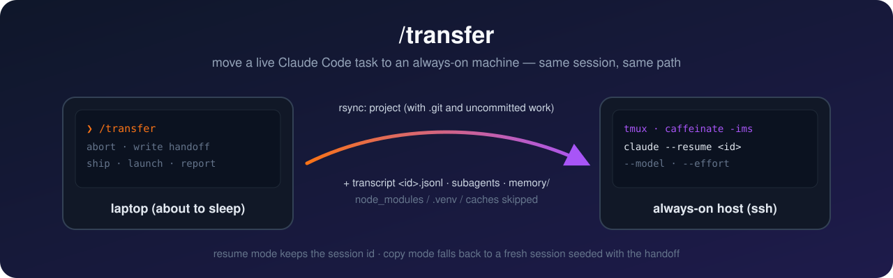

# transfer — hand a running Claude Code task to another machine



Your laptop is about to sleep, or you're about to leave the house, and Claude is halfway through a long task. Type `/transfer` and the work keeps going on an always-on Mac (an ssh host, `mini` by default). It is the **same conversation**: full history, same session id, same project path, and Remote Control stays attached. Claude runs inside tmux under `caffeinate`, so you can attach from anywhere, or keep following it from your phone.

## What you get

- **Same session, not a summary.** The transcript (`<id>.jsonl`, subagent logs, tool results) and project memory are copied next to the project. The remote then runs `claude --resume <id>`.
- **Your working tree as-is.** `.git` and uncommitted or untracked work go along. Regenerable dirs (`node_modules`, `.venv`, caches) are skipped.
- **Pick the brain on the other side.** `-M opus -E xhigh` launches the remote session with a specific model and effort level.
- **Reuses a checkout that is already there.** If the remote already has the project at the same path as a git checkout of the same repo, it saves that checkout's uncommitted changes on a `wip/transfer-<ts>` branch, fast-forwards the branch to `origin`, and resumes the same session there (sync mode). Memory is synced both ways.
- **Same Claude config on both ends.** `~/.claude` (CLAUDE.md, settings and hooks, rules, skills, memory) is a git checkout of a private config repo on each machine and is synced through git before every transfer, with a secret scan; sessions and credentials stay out. `-K` syncs config only.
- **Safe by default.** It never rsyncs into an existing remote directory; anything else falls back to copy mode. The payload has a 2 GiB guard, and remote disk space is checked before anything is sent. Nothing local is changed.
- **Copy-mode fallback.** When the same path can't be used, a fresh remote session starts from a handoff brief that Claude writes before leaving.

## Install

```sh
git clone https://github.com/StevenLi-phoenix/transfer-skill ~/.claude/skills/transfer
```

You need an ssh host with `claude` (logged in) and `tmux`, plus `rsync` on both ends. The script is macOS `/bin/bash` 3.2 compatible and works with macOS openrsync.

## Use

In Claude Code:

```
/transfer                    # move the task to mini (resume mode when possible)
/transfer <hint>             # extra instructions for the remote session
/transfer --host <h>         # another ssh host
/transfer --mode <m>         # remote --permission-mode (auto|acceptEdits|bypassPermissions|manual|plan)
/transfer --model opus       # remote --model
/transfer --effort xhigh     # remote --effort (low|medium|high|xhigh|max)
/transfer --inherit          # remote uses this session's model and effort (-I)
/transfer --branch main      # sync mode: branch to fast-forward the remote checkout to
/transfer --copy             # fresh remote session from the handoff instead of resuming
```

The script on its own:

```sh
transfer.sh -n <src_dir>                                         # dry run: prints MODE=resume|sync|copy and why
transfer.sh [-H host] [-m mode] [-M model] [-E effort | -I] [-B branch] [-C] [-f] <src_dir> TRANSFER.md
```

It prints `HOST= MODE= DEST= SESSION= STATE= ATTACH= PULLBACK=` lines. To watch the remote session, run the `ATTACH` command (detach with `Ctrl-b d`). The `PULLBACK` command brings the remote transcript home, so you can resume the conversation locally again later.

## How it works

1. Claude stops work locally and writes a short `TRANSFER.md`: what's different on the remote, the next steps, and your extra instructions.
2. `transfer.sh` probes the remote without changing anything, picks resume or copy mode, and rsyncs the project.
3. It copies the session transcript last, so the remote gets the most context.
4. It starts `tmux` → `caffeinate -ims claude --resume <id> …`, answers the folder-trust dialog, and waits until Claude is up.

See [SKILL.md](SKILL.md) for the full procedure Claude follows and the gotchas.

## License

MIT
